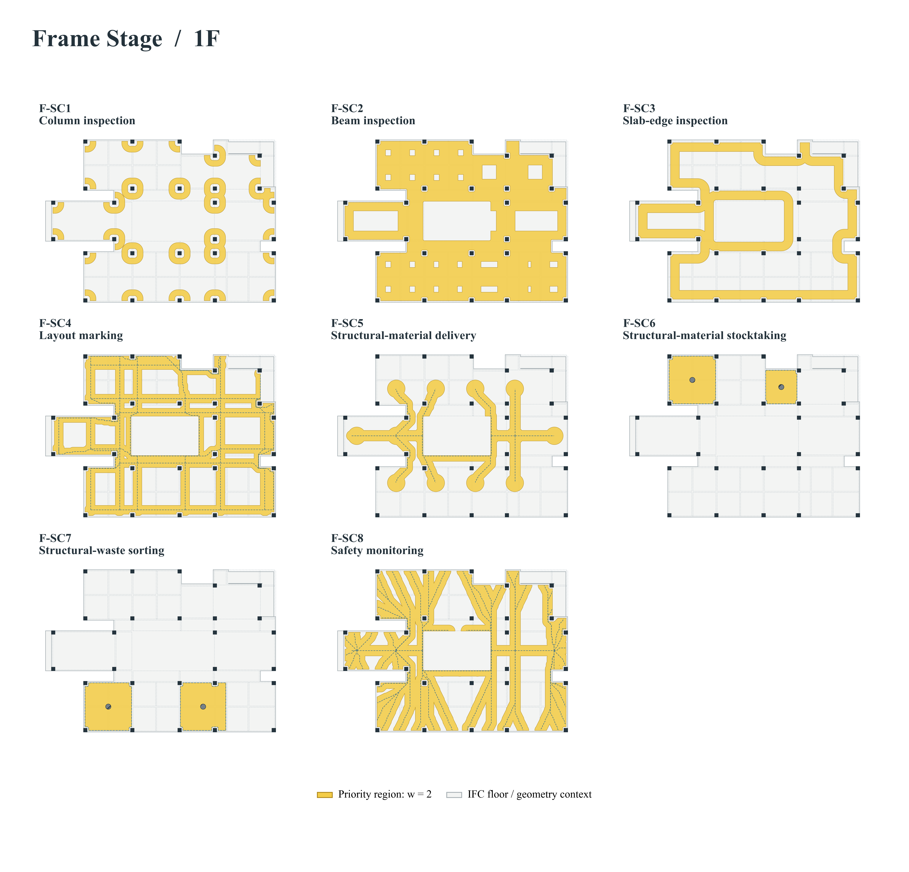
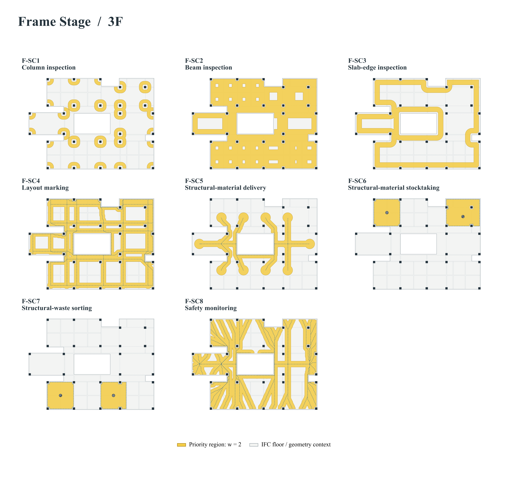
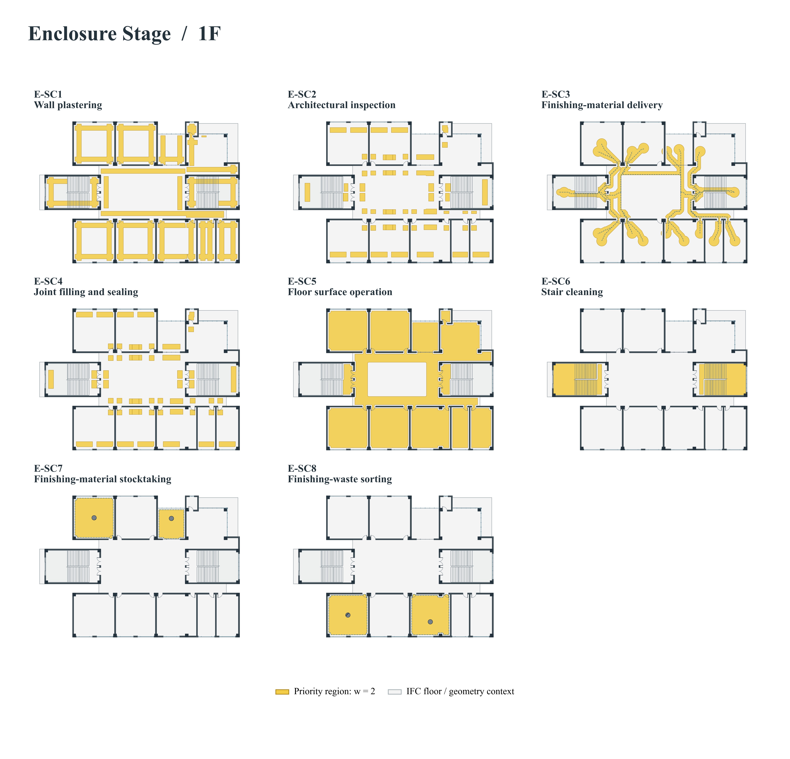
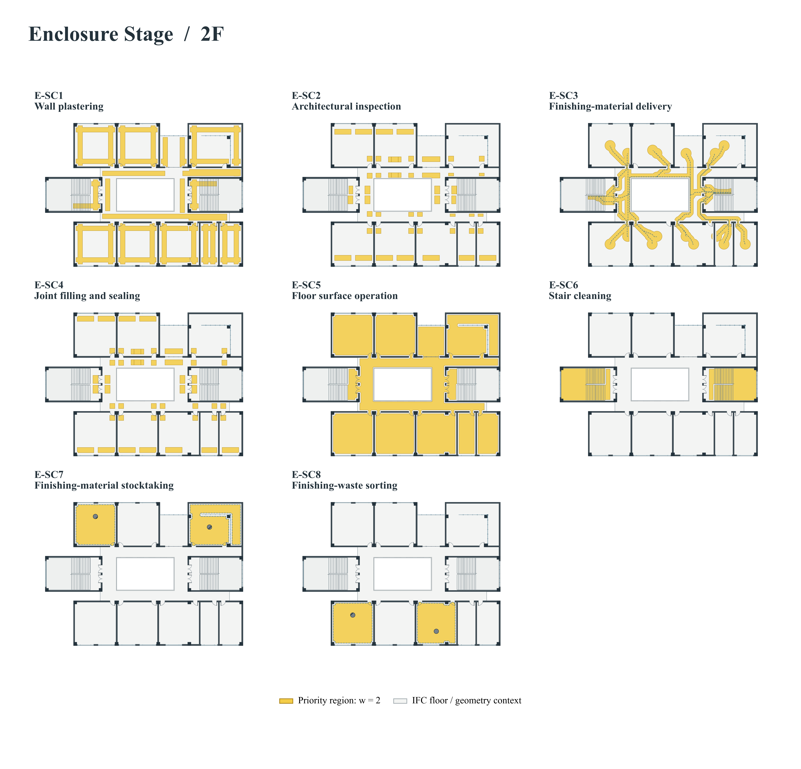

# Construction-stage scenario visualizations

These images correspond to the manuscript case study (Section 4.1). Yellow areas mark priority operating regions; the IFC floor geometry provides spatial context. The current scenario set contains F-SC1–F-SC8 and E-SC1–E-SC8.

## Floor overviews

| Stage | 1F | 2F | 3F |
| --- | --- | --- | --- |
| Structural frame |  |  |  |
| Wall and enclosure |  |  |  |

## Scenario images

Each scenario has an annotated priority-region plan and a 3D view. The floor overviews above show how the scenarios appear on 1F, 2F, and 3F.

| Scenario | Operating activity | Priority-region plan | 3D view |
| --- | --- | --- | --- |
| F-SC1 | Column inspection | [Plan](frame/scenarios/F-SC1_Column_inspection.png) | [3D view](frame/scenarios/F-SC1_3D.png) |
| F-SC2 | Beam inspection | [Plan](frame/scenarios/F-SC2_Beam_inspection.png) | [3D view](frame/scenarios/F-SC2_3D.png) |
| F-SC3 | Slab-edge inspection | [Plan](frame/scenarios/F-SC3_Slab-edge_inspection.png) | [3D view](frame/scenarios/F-SC3_3D.png) |
| F-SC4 | Layout marking | [Plan](frame/scenarios/F-SC4_Layout_marking.png) | [3D view](frame/scenarios/F-SC4_3D.png) |
| F-SC5 | Structural-material delivery | [Plan](frame/scenarios/F-SC5_Structural-material_delivery.png) | [3D view](frame/scenarios/F-SC5_3D.png) |
| F-SC6 | Structural-material stocktaking | [Plan](frame/scenarios/F-SC6_Structural-material_stocktaking.png) | [3D view](frame/scenarios/F-SC6_3D.png) |
| F-SC7 | Structural-waste sorting | [Plan](frame/scenarios/F-SC7_Structural-waste_sorting.png) | [3D view](frame/scenarios/F-SC7_3D.png) |
| F-SC8 | Safety monitoring | [Plan](frame/scenarios/F-SC8_Safety_monitoring.png) | [3D view](frame/scenarios/F-SC8_3D.png) |
| E-SC1 | Wall plastering | [Plan](enclosure/scenarios/E-SC1_Wall_plastering.png) | [3D view](enclosure/scenarios/E-SC1_3D.png) |
| E-SC2 | Architectural inspection | [Plan](enclosure/scenarios/E-SC2_Architectural_inspection.png) | [3D view](enclosure/scenarios/E-SC2_3D.png) |
| E-SC3 | Finishing-material delivery | [Plan](enclosure/scenarios/E-SC3_Finishing-material_delivery.png) | [3D view](enclosure/scenarios/E-SC3_3D.png) |
| E-SC4 | Joint filling and sealing | [Plan](enclosure/scenarios/E-SC4_Joint_filling_and_sealing.png) | [3D view](enclosure/scenarios/E-SC4_3D.png) |
| E-SC5 | Floor surface operation | [Plan](enclosure/scenarios/E-SC5_Floor_surface_operation.png) | [3D view](enclosure/scenarios/E-SC5_3D.png) |
| E-SC6 | Stair cleaning | [Plan](enclosure/scenarios/E-SC6_Stair_cleaning.png) | [3D view](enclosure/scenarios/E-SC6_3D.png) |
| E-SC7 | Finishing-material stocktaking | [Plan](enclosure/scenarios/E-SC7_Finishing-material_stocktaking.png) | [3D view](enclosure/scenarios/E-SC7_3D.png) |
| E-SC8 | Finishing-waste sorting | [Plan](enclosure/scenarios/E-SC8_Finishing-waste_sorting.png) | [3D view](enclosure/scenarios/E-SC8_3D.png) |

## Additional images

The `frame/building/` and `enclosure/building/` directories contain building models and floor plans. `cache/` contains scenario volume and architecture images used in the figure workflow. The scenario boundaries and naming follow the current 16-scenario set; older F-SC9 labels are excluded.
