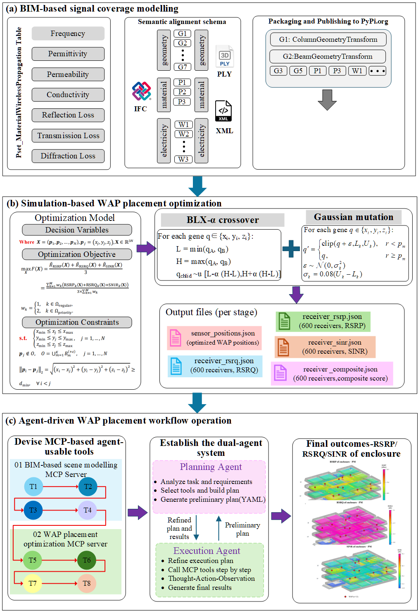
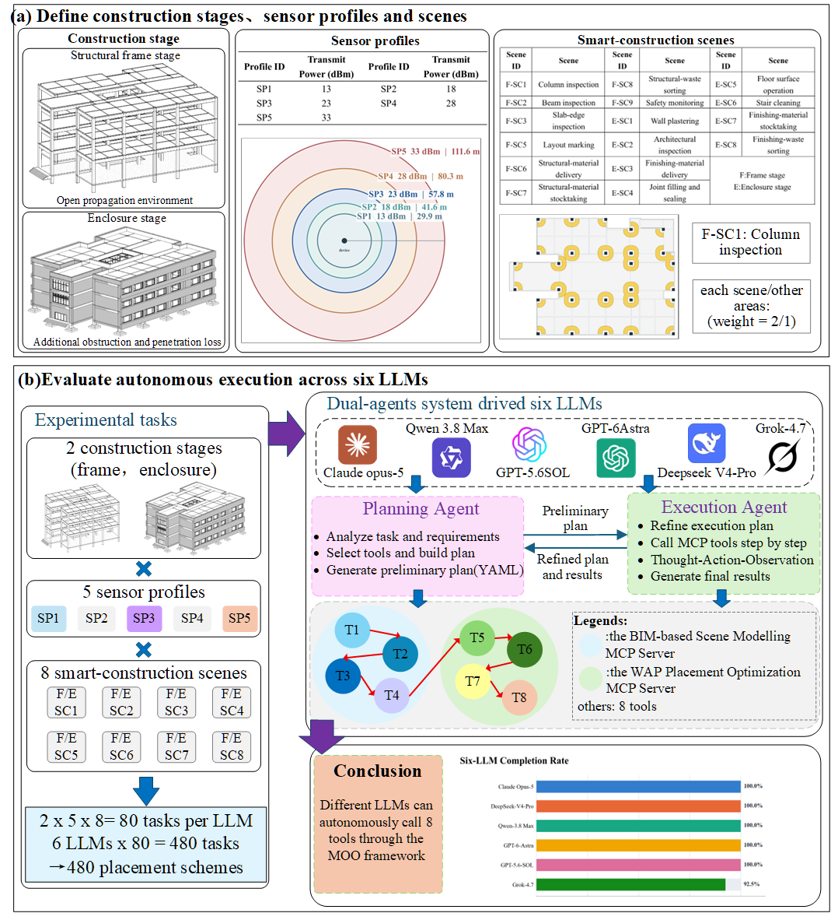
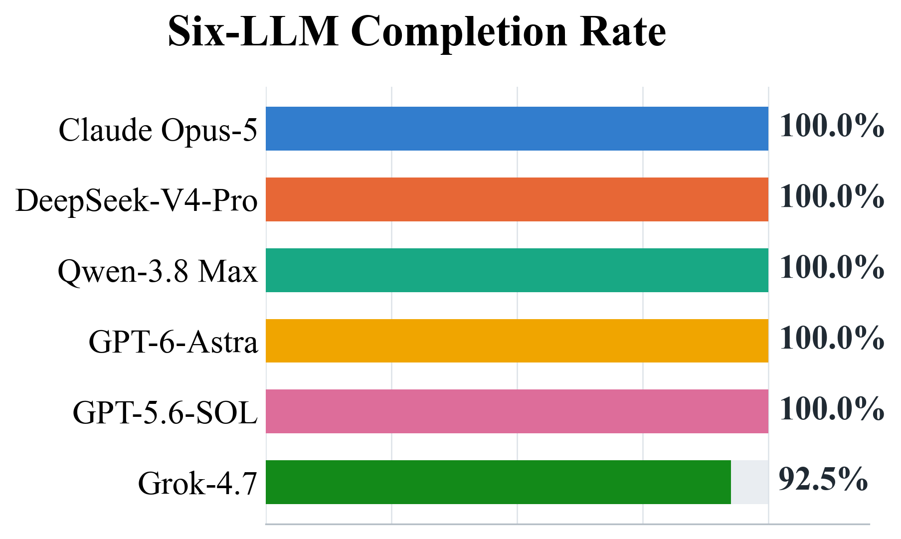

# Placement of Wireless Access Points for Smart Construction Using LLM-Driven Agents

This repository contains code, input data, selected results, figures, and supplementary tables for the manuscript **“Placement of Wireless Access Points for Smart Construction Using LLM-Driven Agents.”** It studies wireless access point (WAP) placement during the structural frame and wall-and-enclosure stages of a primary school teaching building. The proposed **Modelling–Optimization–Operation (MOO)** framework links BIM-based signal coverage modelling, simulation-based WAP placement optimization, and agent-driven workflow operation.

## Find the materials

| Manuscript section | Repository materials |
| --- | --- |
| **3.1 BIM-based signal coverage modelling** | [`ifc2xml_ply/`](ifc2xml_ply/) contains the IFC-to-PLY/XML conversion library and example IFC models. [`MOO_Framework/data/`](MOO_Framework/data/) contains the experiment inputs. [Table S1](Supplementary_Tables/S1/) documents material properties and semantic mapping. [Figure 2](Figures/Fig_02.png) shows the mapping schema. |
| **3.2 Simulation-based WAP placement optimization** | [`MOO_Framework/tools/wap_layout_optimization/`](MOO_Framework/tools/wap_layout_optimization/) contains problem definition, candidate generation, surrogate construction, and optimization. [Table S2](Supplementary_Tables/S2/) records optimization and evaluation settings. [Figure 4](Figures/Fig_04.png) shows the genetic-algorithm workflow. |
| **3.3 Agent-driven WAP placement workflow operation** | [`MOO_Framework/agents/`](MOO_Framework/agents/) and [`MOO_Framework/mcp_servers/`](MOO_Framework/mcp_servers/) implement the dual-agent workflow and two MCP servers. BIM and WAP tools are under [`MOO_Framework/tools/`](MOO_Framework/tools/). See [Figures 5–6](Figures/). |
| **4.1 Building profile and scenario settings** | [`MOO_Framework/data/ifc/`](MOO_Framework/data/ifc/), [`data/regions/`](MOO_Framework/data/regions/), and [Table S3](Supplementary_Tables/S3/) contain the building and scenario inputs. [Figure 7](Figures/Fig_07.png) outlines the stage-aware experiment. |
| **4.2.1 Expert-based comparison** | [`MOO_Framework/baselines/`](MOO_Framework/baselines/), [`run_experiment_expert.py`](MOO_Framework/run_experiment_expert.py), and [Table S4](Supplementary_Tables/S4/) support EbM1–EbM3 versus the proposed method (PM). See [Figures 9–10](Figures/). |
| **4.2.2 Geometric coverage comparison** | [`run_experiment_geometric.py`](MOO_Framework/run_experiment_geometric.py), the geometric baseline code, and [Table S4](Supplementary_Tables/S4/) support GcM1–GcM2 versus PM. See [Figures 11–12](Figures/). |
| **4.2.3 Six-LLM task completion** | [`send_task2.py`](MOO_Framework/send_task2.py), [`result/six_llm/`](MOO_Framework/result/six_llm/), and [Table S5](Supplementary_Tables/S5/) provide the task runner, audit records, and completion summary. [Figure 13](Figures/Fig_13.png) shows completion rates. |

The [figure index](Figures/) lists every extracted manuscript image, including the six stage-by-metric heatmaps of Figure 8. Each [supplementary table](Supplementary_Tables/) includes a formatted Excel workbook and separately browsable CSV exports of its worksheets.

## Case study and results

The case study compares PM with three expert-based schemes (EbM1–EbM3) and two geometric coverage schemes (GcM1–GcM2). Wireless performance is reported with reference signal received power (RSRP), reference signal received quality (RSRQ), and signal-to-interference-plus-noise ratio (SINR). Figure 8 shows PM heatmaps for both construction stages.

The repository's formal six-LLM records cover **480 assigned tasks**: six models × two stages × five sensor profiles × eight scenarios. **474 tasks succeeded** under the single-attempt policy. This matrix comes from the included task manifest and [Table S5](Supplementary_Tables/S5/). The completion metric measures whether the agents completed the eight-tool sequence; it does not by itself establish dense-domain radio coverage.

## Reproduce the code workflows

The runnable MOO project is under one root so its relative paths and Python imports stay consistent. Start in [`MOO_Framework/`](MOO_Framework/) and follow its [setup instructions](MOO_Framework/README.md). The standalone IFC converter has a separate [usage guide](ifc2xml_ply/README.md).

Large generated radio maps, logs, working plots, local credentials, and manuscript drafts are excluded. The optimization checks 600 selected receivers and 150 candidate WAP sites; any minimum-count conclusion applies to that finite set. This repository is currently **private**.
