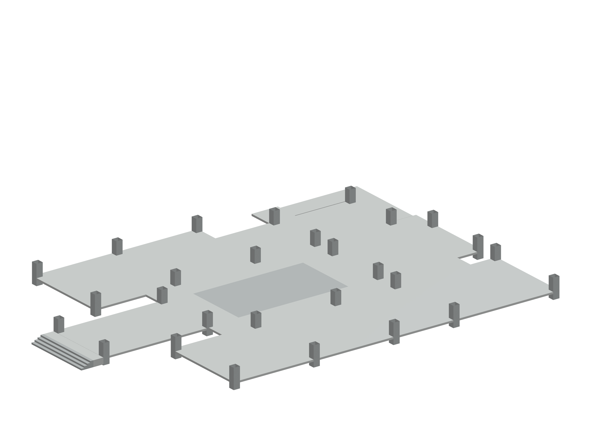

# Placement of Wireless Access Points for Smart Construction Using LLM-Driven Agents


> **MOO (Modelling-Optimization-Operation) Framework**: Integrating BIM data, Sionna RT ray-tracing, genetic algorithm optimization, and LLM-driven dual-agent workflow automation for construction-stage-aware WAP placement


---

# 1 Summary of supplemental materials
This table below summarizes the key directories of this repository and the supplemental materials supporting the paper.


The supplemental materials (`Supplementary_Tables/`) include the following tables:

| Table | Content |
|-------|---------|
| Table S1 | Materials and Mapping — IFC material definitions, radio material class assignments, and literature sources |
| Table S2 | Optimization and Evaluation — Pset_MaterialWirelessPropagation property audit, electromagnetic parameter library, IFC-to-PLY&XML entity mapping |
| Table S3 | Scenario Configuration — Construction stages, sensor profiles (SP1–SP5), and smart construction scenes (SC1–SC8) |
| Table S4 | Scheme Performance — PM vs. expert-based and geometric coverage baseline scores |
| Table S5 | Six-LLM Run Records — 480-task completion audit across six LLMs |


# 2 General Introduction

2.1 This repository aims at providing the codes and data regarding the paper entitled **"Placement of Wireless Access Points for Smart Construction Using LLM-Driven Agents"** for the public.

2.2 We greatly appreciate the selfless spirits of the voluntary contributors of a series of open Python libraries, including **IfcOpenShell** (https://github.com/IfcOpenShell/IfcOpenShell), **Sionna RT** (https://github.com/NVlabs/sionna), **trimesh**, **shapely**, and so on. Our work stands on the shoulders of these giants.

2.3 As for anything regarding the copyright, please refer to the MIT License or contact the authors.


# 3 Methodology

The MOO framework comprises three core components: (i) BIM-based signal coverage modelling, (ii) simulation-based WAP placement optimization, and (iii) agent-driven WAP placement workflow operation.

## 3.1 BIM-based signal coverage modelling

The data transformation from BIM's IFC format to Sionna RT-compatible PLY meshes and XML scene files avoids manually and repeatedly establishing the building model for wireless signal simulations. This process involves three main steps: (i) extending the IFC material description with wireless-propagation properties (`Pset_MaterialWirelessPropagation`), (ii) devising the mapping schema between IFC, PLY, and XML, and (iii) developing the **IFC2PLY&XML function library**.

This library includes **17 core functions** divided into three groups: **G-series** (geometry conversion, 7 functions), **P-series** (material property conversion, 3 functions), and **W-series** (wireless-propagation property conversion, 7 functions).


↑↑↑ The IFC2PLY&XML function library released as an open-source Python package (`pip install ifc2ply_xml`)

The G-series functions convert IFC building elements (columns, beams, walls, doors, windows, slabs, roofs) into vertex-based PLY meshes. The P-series functions map IFC material attributes to XML entries. The W-series functions encode wireless-propagation properties including reflection loss, transmission loss, and diffraction loss parameters.


↑↑↑ Signal coverage models for the frame stage (left) and enclosure stage (right), constructed from IFC data via the IFC2PLY&XML library

### Floor-level visualization bases




↑↑↑ Frame stage — Floor 1, 2, 3 cutaway views


↑↑↑ Enclosure stage — Floor 1, 2, 3 cutaway views


## 3.2 Simulation-based WAP placement optimization

The WAP placement optimization maximizes a weighted composite signal quality score of **RSRP**, **RSRQ**, and **SINR** across 600 formal receiver positions, using a **genetic algorithm (GA)** with real-valued chromosome encoding.

The optimization model:

| Component | Configuration |
|-----------|--------------|
| Objective | Maximize weighted composite F = mean(wᵢ · norm(RSRPᵢ, RSRQᵢ, SINRᵢ)) |
| Priority weight | w = 2 (priority zones), w = 1 (regular areas) |
| Decision variables | 3D WAP coordinates (x, y, z) |
| Receivers | 600 fixed positions per stage |
| Candidate WAP sites | 150 (mixed receiver-derived + scene-centre + grid anchors) |
| Minimum WAP spacing | 4.0 m |
| Obstacle clearance | ≥ 0.05 m |
| Thresholds | RSRP ≥ −140 dBm, RSRQ ≥ −19.5 dB, SINR ≥ 0 dB |

The GA configuration:

| Operator | Setting |
|----------|---------|
| Population size | 80 |
| Generations | 35 |
| Selection | Tournament (size 4) |
| Crossover | BLX-α (α = 0.5) |
| Mutation | Gaussian, adaptive σ |
| Ray-tracing | Sionna RT RadioMapSolver, 1,000,000 samples/TX, 0.75 m cell size |
| Propagation | LoS, specular reflection, diffraction, refraction enabled |

The WAP count is determined iteratively from N = 1: progressively add WAPs and re-optimize locations until all 600 receivers satisfy the three RF thresholds simultaneously. The GA starts from multiple independently-found RF-feasible layouts to avoid premature convergence.

Below are the WAP placement optimization codes and baseline comparison codes:

```
MOO_Framework/tools/wap_layout_optimization/
├── define_problem.py        ← Optimization problem formulation
├── build_surrogate.py        ← Sionna RT surrogate model construction
├── generate_candidates.py    ← 150-site candidate dictionary generation
└── optimize.py              ← GA-based layout optimization + 600-point evaluation

MOO_Framework/baselines/
├── expert_layouts.py        ← EbM1 (Huawei), EbM2 (Akuvox), EbM3 (Siemens)
├── geometric_layouts.py     ← GcM1 (hexagonal), GcM2 (circular) coverage
├── geometry.py              ← Geometric coverage primitives
└── score.py                 ← Unified scoring on common Sionna comparison map
```

↑↑↑ Codes for simulation-based WAP placement optimization and baseline comparisons


## 3.3 Agent-driven WAP placement workflow operation

The agent system automates the complete WAP placement workflow through a **dual-agent plan-and-execute architecture** orchestrating **8 MCP-based agent-usable tools** across **2 MCP servers**.

### MCP Server and Tool Architecture

```
Human Request
     │
     ▼
┌─────────────────┐
│  Planning Agent  │  ← LLM reasoning core
│  (Preliminary    │
│   12-step plan)  │
└────────┬────────┘
         │
         ▼
┌─────────────────┐
│ Execution Agent  │  ← LLM reasoning core (Thought → Action → Observation)
│  (Refine plan &  │
│   invoke tools)  │
└────────┬────────┘
         │
    ┌────┴──────────┐
    ▼               ▼
┌────────────┐ ┌────────────┐
│ BIM MCP    │ │ WAP MCP    │
│ Server     │ │ Server     │
│ (Port 8101)│ │ (Port 8102)│
│            │ │            │
│ 4 tools:   │ │ 4 tools:   │
│ 1.Parse    │ │ 5.Define   │
│ 2.Tessell. │ │ 6.Surrogate│
│ 3.Export   │ │ 7.Candidate│
│ 4.Mitsuba  │ │ 8.Optimize │
└────────────┘ └────────────┘
```

The 8 tools are organized into two MCP servers:

**BIM-based Scene Modelling MCP Server** (`MOO_Framework/mcp_servers/bim_server.py`):
| Tool | Function | Code |
|------|----------|------|
| 1. Parse IFC Building | Parse IFC file, extract building elements and material associations | `MOO_Framework/tools/bim_data_processing/parse_ifc_building.py` |
| 2. Tessellate IFC Objects | Triangulate IFC elements into mesh geometry | `MOO_Framework/tools/bim_data_processing/tessellate_ifc_objects.py` |
| 3. Export Object Meshes | Export PLY meshes + XML scene file with radio materials | `MOO_Framework/tools/bim_data_processing/export_object_meshes.py` |
| 4. Generate Mitsuba Scene | Produce Sionna-compatible Mitsuba XML scene | `MOO_Framework/tools/bim_data_processing/generate_mitsuba_scene.py` |

**WAP Placement Optimization MCP Server** (`MOO_Framework/mcp_servers/wap_server.py`):
| Tool | Function | Code |
|------|----------|------|
| 5. Define Problem | Set up optimization objectives, constraints, and sensor profile | `MOO_Framework/tools/wap_layout_optimization/define_problem.py` |
| 6. Build Surrogate | Build Sionna RT radio map surrogate model | `MOO_Framework/tools/wap_layout_optimization/build_surrogate.py` |
| 7. Generate Candidates | Generate and validate 150-site candidate dictionary | `MOO_Framework/tools/wap_layout_optimization/generate_candidates.py` |
| 8. Optimize | Run GA optimization + evaluate 600-receiver results | `MOO_Framework/tools/wap_layout_optimization/optimize.py` |

A **shared structured data record** maintains data continuity across the tool chain. Each tool reads required upstream data and appends its own outputs, preserving all previously generated information for subsequent tools.

### Dual-Agent System

The planning agent (`MOO_Framework/agents/planning_agent.py`) and execution agent (`MOO_Framework/agents/execution_agent.py`) follow a **plan-and-execute** pattern:

1. **Planning Agent** — Receives the human task request, identifies required inputs/outputs, decomposes into an ordered preliminary plan
2. **Execution Agent** — Validates the plan against available MCP tools, repairs missing arguments, produces final execution sequence, and invokes all 8 tools with **Thought–Action–Observation** logging

Each of the **six candidate LLMs** (Claude Opus 5, DeepSeek, Qwen, GPT-6, GPT-5.6 Sol, Grok 4.3) can drive both agents. Evaluation uses a common task matrix with **task completion rate** (all 8 MCP tool calls successful) as the metric.

```
MOO_Framework/agents/
├── planning_agent.py        ← Receives task, generates 12-step preliminary plan
└── execution_agent.py       ← Validates plan, invokes 8 MCP tools, logs Thought-Action-Observation

MOO_Framework/mcp_servers/
├── bim_server.py            ← Exposes 4 BIM scene modelling tools via MCP
└── wap_server.py            ← Exposes 4 WAP optimization tools via MCP
```

↑↑↑ Codes for the dual-agent system and MCP servers


## 3.4 Optimization results and performance comparison

5 baseline schemes are developed for comparison with the **Proposed Method (PM)**:

**Expert-based Approaches**: Huawei-inspired (EbM1), Akuvox-inspired (EbM2), Siemens-inspired (EbM3)

**Geometric Coverage Methods**: Hexagonal deployment (GcM1), Circular deployment (GcM2)

### 3.4.1 SP3 / SC1 core experimental results

The MOO framework uses DeepSeek, SP3 at 23 dBm, SC1 priority weight 2, 600 fixed receivers per stage, 150 candidate WAP sites, and Sionna RadioMapSolver at 0.75 m cell size with 1,000,000 samples per transmitter.

| Stage | PM WAPs | PM F (optimization map) | PM F (common comparison map) | Best baseline F | PM failures / 600 | Min. count proven |
|-------|---------|------------------------|------------------------------|-----------------|-------------------|-------------------|
| Frame | 3 | 0.997597 | 0.997597 | 0.995065 (EbM1/EbM2) | 0 | Yes |
| Enclosure | 12 | 0.987974 | 0.986763 | 0.784174 (EbM3) | 0 | Yes |

All six methods use equal WAP counts per stage for fair comparison. Scores are computed on an identical Sionna RadioMapSolver comparison map.

### 3.4.2 Comparison with expert-based deployment methods

| Method | Description | Frame F | Enclosure F | PM uplift (Frame) | PM uplift (Enclosure) |
|--------|-------------|---------|-------------|-------------------|----------------------|
| **PM** | Proposed Method (MOO) | **0.998** | **0.987** | — | — |
| EbM1 | Huawei-inspired deployment | 0.995 | 0.673 | +0.3% | +46.6% |
| EbM2 | Akuvox-inspired deployment | 0.995 | 0.679 | +0.3% | +45.4% |
| EbM3 | Siemens-inspired deployment | 0.983 | 0.784 | +1.5% | +25.8% |

PM outperforms all three expert-based methods in both construction stages. The performance advantage is particularly significant in the enclosure stage where walls and partitions introduce substantial signal attenuation that expert-based rules-of-thumb cannot adequately account for.

### 3.4.3 Comparison with geometric coverage methods

| Method | Description | Frame F | Enclosure F | PM uplift (Frame) | PM uplift (Enclosure) |
|--------|-------------|---------|-------------|-------------------|----------------------|
| **PM** | Proposed Method (MOO) | **0.998** | **0.987** | — | — |
| GcM1 | Hexagonal coverage + GA | 0.860 | 0.674 | +16.0% | +46.3% |
| GcM2 | Circular coverage + GA | 0.792 | 0.682 | +25.9% | +44.7% |

PM substantially outperforms both geometric methods, demonstrating that idealized coverage shapes (hexagons, circles) fail to capture obstacle-dependent signal attenuation and complex multipath propagation in construction environments.

### 3.4.4 Six-LLM agent task completion rates

The six-LLM benchmark covers **480 formal tasks** (6 models × 2 stages × 5 sensor profiles × 8 scenarios per stage). Sensor profiles SP1–SP5 correspond to transmit powers of 13, 18, 23, 28, and 33 dBm at 3.5 GHz.

| Model | Family | Tasks completed | Tasks assigned | Completion rate |
|-------|--------|----------------|----------------|-----------------|
| Claude Opus 5 | Anthropic | 80 | 80 | 100% |
| DeepSeek | DeepSeek | 80 | 80 | 100% |
| Qwen (Qianwen) | Alibaba | 80 | 80 | 100% |
| GPT-6 | OpenAI | 80 | 80 | 100% |
| GPT-5.6 Sol | OpenAI | 80 | 80 | 100% |
| Grok 4.3 | xAI | 74 | 80 | 92.5% |
| **Total** | | **474** | **480** | **98.75%** |

Of 480 assigned tasks, **474 succeeded**; six Grok-4.7 tasks failed at the LLM/API layer under the single-attempt policy. The success criterion requires: the LLM drives both planning and execution phases, all 8 MCP tool calls return success, and the overall task status indicates success.

The full task matrix and per-task audit records are available in:
- `MOO_Framework/result/six_llm/completion_rate.json` — Per-model completion rates
- `MOO_Framework/result/six_llm/tasks/` — One JSON record per task (480 records)
- `MOO_Framework/result/six_llm/completion_rate.csv` — Completion rate CSV
- `Supplementary_Tables/Table_S5_Six_LLM_Run_Records.xlsx` — Detailed run records


# 4 Discussion

## 4.1 Case of educational facility

A primary school teaching building (37.45 m × 27.00 m × 13.50 m, plan area 1,011.15 m², three floors) is selected as the demonstrative case.

The experimental design spans three dimensions:
- **2 construction stages**: Structural frame stage, Wall-and-enclosure stage
- **5 sensor profiles (SP1–SP5)**: 13, 18, 23, 28, 33 dBm at 3.5 GHz
- **8 smart construction scenes per stage (SC1–SC8)**: Column/beam/slab inspection, layout marking, material delivery/stocktaking, waste sorting, safety monitoring (frame); Wall plastering, architectural inspection, material delivery/stocktaking, joint filling, floor surface operation, stair cleaning, waste sorting (enclosure)

Each scene has a dedicated 3D priority volume (zones weighted 2× for signal quality), while all remaining areas are assigned weight 1×.

The per-floor coordinate-registered heatmaps and violin plots comparing PM against all baselines are generated by:
```
python MOO_Framework/plot_registered_floor_heatmaps.py   ← Per-floor RSRP/RSRQ/SINR heatmaps
python MOO_Framework/plot_stacked_registered_heatmaps.py ← 3D stacked floor overviews
python MOO_Framework/plot_group_violin.py               ← Per-receiver distribution violin plots
python MOO_Framework/plot_uplift.py                     ← Composite score uplift bar charts
```

## 4.2 Transferability of the MOO framework

The transferability of the MOO framework lies in its reusable modelling, optimization, and operation components:

- **Modelling**: The IFC2PLY&XML function library processes selected BIM elements and converts exported IFC files into PLY/XML simulation scenes. Building geometry, material properties, and radio parameters are configurable per project.
- **Optimization**: WAP parameters, receiver locations and weights, and signal coverage requirements can be reconfigured without code changes.
- **Operation**: The agent pattern and tool-calling workflow remain unchanged across projects. Task instructions and tool inputs adapt to new buildings. Agent-compatible tools and MCP servers can be added or adjusted.

## 4.3 Method and result boundaries

- The WAP count search and GA use **600 selected receiver positions** and **150 candidate WAP sites**. The minimum-count proof applies to this finite set.
- Independent dense-domain probes can still fail (PM: 6/13,818 frame positions; 185/12,071 enclosure positions). The minimum-count claim does **not** prove all points in the continuous work domain satisfy thresholds.
- The **global optimum** over all physical installation sites has not been proven; PM reports the highest observed F among the six-method comparison.
- The formal six-LLM completion rate is based on successful eight-tool execution, not dense-domain validation.


# 5 Quick start

## 5.1 Environment setup

```powershell
# Clone the repository
git clone https://github.com/yuzhongdexishu/wap-placement-moo.git
cd wap-placement-moo

# Install dependencies (Python 3.11 required)
python -m pip install -r MOO_Framework/requirements.txt

# Configure credentials
Copy-Item MOO_Framework/config/llm_config.example.json MOO_Framework/config/llm_config.json
Copy-Item MOO_Framework/config/models.example.json MOO_Framework/config/models.json
```

Edit `MOO_Framework/config/llm_config.json` and `MOO_Framework/config/models.json` with your API credentials. The example files contain empty `api_key` fields. These files are in `.gitignore` and will never be committed.

## 5.2 Run the MOO framework (Proposed Method)

```powershell
cd MOO_Framework

# Terminal 1: Start all four services
python run_all.py
# Starts: BIM MCP Server (:8101), WAP MCP Server (:8102),
#         Planning Agent (:7001), Execution Agent (:7002)

# Terminal 2: Submit the PM task
python send_task_moo.py
# Runs frame + enclosure stages, SP3 (23 dBm), SC1 priority scenario
```

Or launch services in background:
```powershell
cd MOO_Framework
.\_launch_services2.ps1
```

## 5.3 Run baseline comparisons

```powershell
cd MOO_Framework
python run_experiment_expert.py       # Expert baselines (EbM1/EbM2/EbM3)
python run_experiment_geometric.py     # Geometric baselines (GcM1/GcM2)
python run_baseline_comparison.py      # Unified comparison on common Sionna map
```

## 5.4 Generate figures

```powershell
cd MOO_Framework
python render_floor_bases.py                # Building floor plan bases
python plot_registered_floor_heatmaps.py     # Per-floor registered heatmaps
python plot_stacked_registered_heatmaps.py   # 3D stacked floor overviews
python plot_group_violin.py                 # Per-receiver violin plots
python plot_uplift.py                       # Uplift bar charts
python plot_3d_metric_heatmaps.py            # Legacy 3D views
```

## 5.5 Run the six-LLM benchmark

```powershell
cd MOO_Framework

# Preview the task plan (no API calls)
python send_task2.py --dry-run

# Launch the full 480-task benchmark
python send_task2.py

# Export the task matrix
python export_task_table.py
```

## 5.6 Use the IFC2PLY&XML library standalone

```bash
# Install from PyPI
pip install ifc2ply_xml

# Convert IFC to PLY meshes + Sionna XML scene
python -m ifc2xml_ply --inputs frame.ifc enclosure.ifc --frequency-ghz 3.5 --output ./output
```

The standalone library is located in `ifc2xml_ply/`:

```
ifc2xml_ply/
├── main.py             ← CLI entry point
├── functions/
│   ├── G1_ColumnGeometryTransform.py    ← G-series: geometry conversion (7 functions)
│   ├── G2_BeamGeometryTransform.py
│   ├── G3_WallGeometryTransform.py
│   ├── G4_DoorGeometryTransform.py
│   ├── G5_WindowGeometryTransform.py
│   ├── G6_SlabGeometryTransform.py
│   ├── G7_RoofGeometryTransform.py
│   ├── P1_MaterialNameTransform.py      ← P-series: material properties (3 functions)
│   ├── P2_MaterialThicknessTransform.py
│   ├── P3_MaterialColorTransform.py
│   ├── W1_FrequencyTransform.py         ← W-series: wireless propagation (7 functions)
│   ├── W2_RelativePermittivityTransform.py
│   ├── W3_RelativePermeabilityTransform.py
│   ├── W4_ConductivityTransform.py
│   ├── W5_ReflectionLossTransform.py
│   ├── W6_TransmissionLossTransform.py
│   └── W7_DiffractionLossTransform.py
└── data/
    ├── frame.ifc
    ├── enclosure.ifc
    ├── material_class_map.csv
    ├── itu_p2040_4_coefficients.csv
    └── expert_radio_parameters.csv
```

↑↑↑ Standalone open-source IFC2PLY&XML function library (also available on PyPI)