# Placement of Wireless Access Points for Smart Construction Using LLM-Driven Agents

> **MOO (Modelling-Optimization-Operation) Framework**: Integrating BIM data, Sionna RT ray-tracing, genetic algorithm optimization, and LLM-driven dual-agent workflow automation for construction-stage-aware WAP placement

---

# 1 Summary of supplemental materials

This table below summarizes the key directories of this repository and the supplemental materials supporting the paper.

|  |  |
|:--:|:--:|
| Frame stage architecture | Enclosure stage architecture |

The supplemental materials (`Supplementary_Tables/`) include the following tables:

| Table | Content |
|-------|---------|
| Table S1 | Materials and Mapping — IFC material definitions, radio material class assignments, and literature sources |
| Table S2 | Optimization and Evaluation — Pset_MaterialWirelessPropagation property audit, electromagnetic parameter library, IFC-to-PLY&XML entity mapping |
| Table S3 | Scenario Configuration — Construction stages, sensor profiles (SP1–SP5), and smart construction scenes (SC1–SC8) |
| Table S4 | Scheme Performance — PM vs. expert-based and geometric coverage baseline scores |
| Table S5 | Six-LLM Run Records — 480-task completion audit across six LLMs |


# 2 General Introduction

2.1 This repository aims at providing the codes and data regarding the paper entitled **"Placement of Wireless Access Points for Smart Construction Using LLM-Driven Agents"** for the public.

2.2 We greatly appreciate the selfless spirits of the voluntary contributors of a series of open Python libraries, including **IfcOpenShell** (https://github.com/IfcOpenShell/IfcOpenShell), **Sionna RT** (https://github.com/NVlabs/sionna), **trimesh**, **shapely**, and so on. Our work stands on the shoulders of these giants.

2.3 As for anything regarding the copyright, please refer to the MIT License or contact the authors.


# 3 Methodology

The MOO framework comprises three core components: (i) BIM-based signal coverage modelling, (ii) simulation-based WAP placement optimization, and (iii) agent-driven WAP placement workflow operation.

## 3.1 BIM-based signal coverage modelling

The data transformation from BIM's IFC format to Sionna RT-compatible PLY meshes and XML scene files avoids manually and repeatedly establishing the building model for wireless signal simulations. This process involves three main steps: (i) extending the IFC material description with wireless-propagation properties (`Pset_MaterialWirelessPropagation`), (ii) devising the mapping schema between IFC, PLY, and XML, and (iii) developing the **IFC2PLY&XML function library**.

This library includes **17 core functions** divided into three groups: **G-series** (geometry conversion, 7 functions), **P-series** (material property conversion, 3 functions), and **W-series** (wireless-propagation property conversion, 7 functions).

|  |  |
|:--:|:--:|
| IFC2PLY&XML function library (`pip install ifc2ply_xml`) | Signal coverage models: frame stage (left) & enclosure stage (right) |

The G-series functions convert IFC building elements (columns, beams, walls, doors, windows, slabs, roofs) into vertex-based PLY meshes. The P-series functions map IFC material attributes to XML entries. The W-series functions encode wireless-propagation properties including reflection loss, transmission loss, and diffraction loss parameters.

### Floor-level visualization bases

|  | 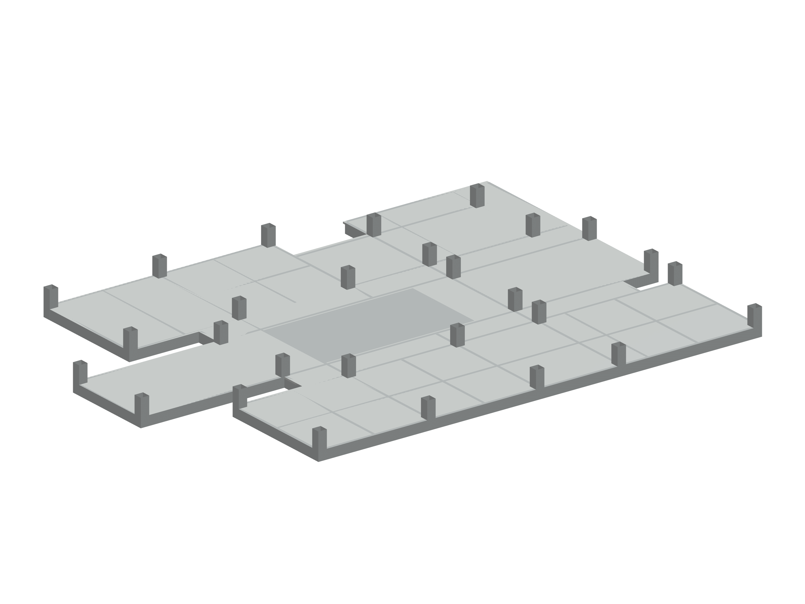 |  |
|:--:|:--:|:--:|
| Frame — Floor 1 | Frame — Floor 2 | Frame — Floor 3 |

| 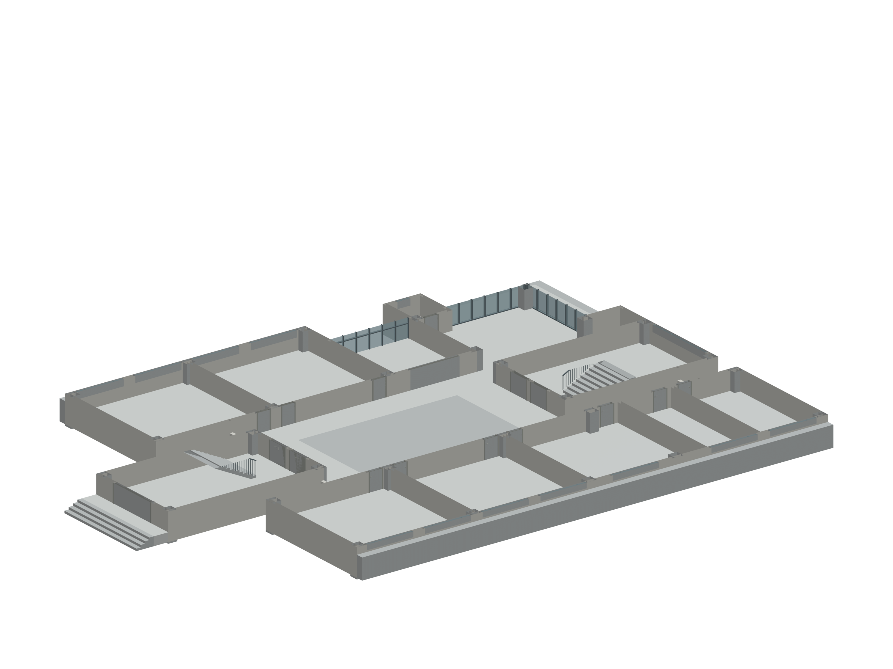 |  | 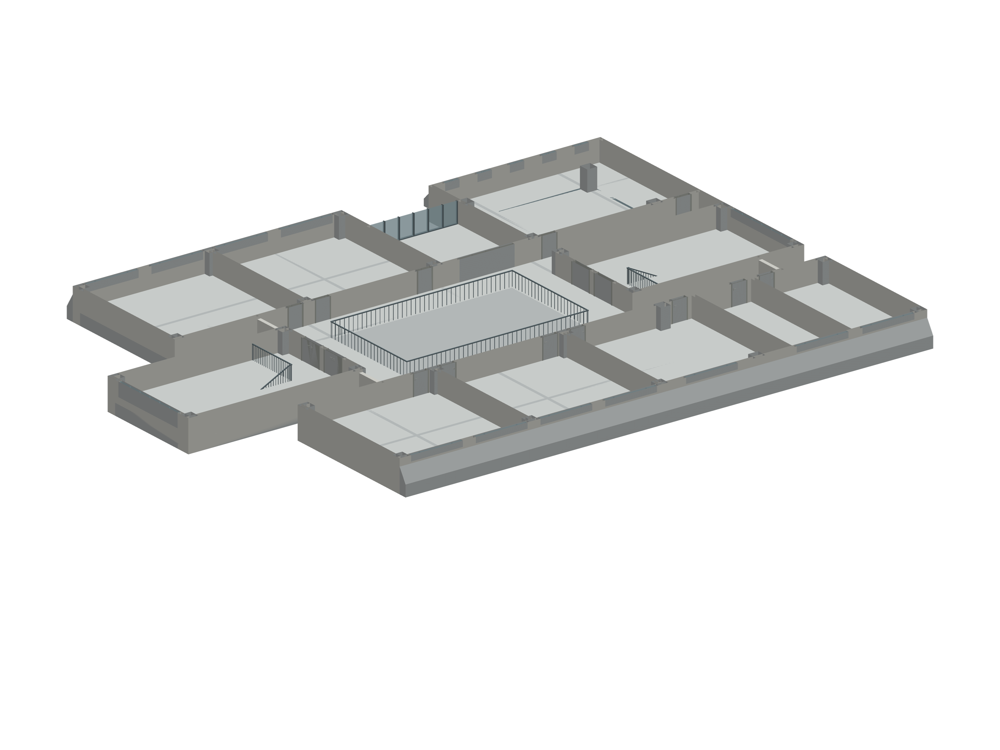 |
|:--:|:--:|:--:|
| Enclosure — Floor 1 | Enclosure — Floor 2 | Enclosure — Floor 3 |


## 3.2 Simulation-based WAP placement optimization

The WAP placement optimization maximizes a weighted composite signal quality score of **RSRP**, **RSRQ**, and **SINR** across 600 formal receiver positions, using a **genetic algorithm (GA)** with real-valued chromosome encoding.

**Optimization model:**

| Component | Configuration |
|-----------|--------------|
| Objective | Maximize weighted composite F = mean(wᵢ · norm(RSRPᵢ, RSRQᵢ, SINRᵢ)) |
| Priority weight | w = 2 (priority zones), w = 1 (regular areas) |
| Decision variables | 3D WAP coordinates (x, y, z) |
| Receivers | 600 fixed positions per stage |
| Candidate WAP sites | 150 (mixed receiver-derived + scene-centre + grid anchors) |
| Minimum WAP spacing | 4.0 m |
| Obstacle clearance | ≥ 0.05 m |
| Thresholds | RSRP ≥ −140 dBm, RSRQ ≥ −19.5 dB, SINR ≥ 0 dB |

**GA configuration:**

| Operator | Setting |
|----------|---------|
| Population size | 80 |
| Generations | 35 |
| Selection | Tournament (size 4) |
| Crossover | BLX-α (α = 0.5) |
| Mutation | Gaussian, adaptive σ |
| Ray-tracing | Sionna RT RadioMapSolver, 1,000,000 samples/TX, 0.75 m cell size |
| Propagation | LoS, specular reflection, diffraction, refraction enabled |

The WAP count is determined iteratively from N = 1. The GA starts from multiple independently-found RF-feasible layouts.

### PM heatmaps — Frame stage (RSRP per floor)

| 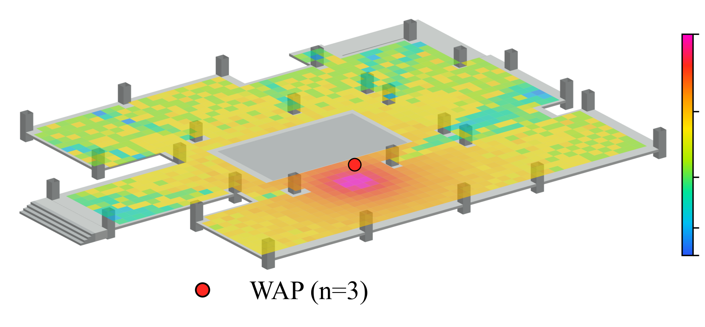 |  | 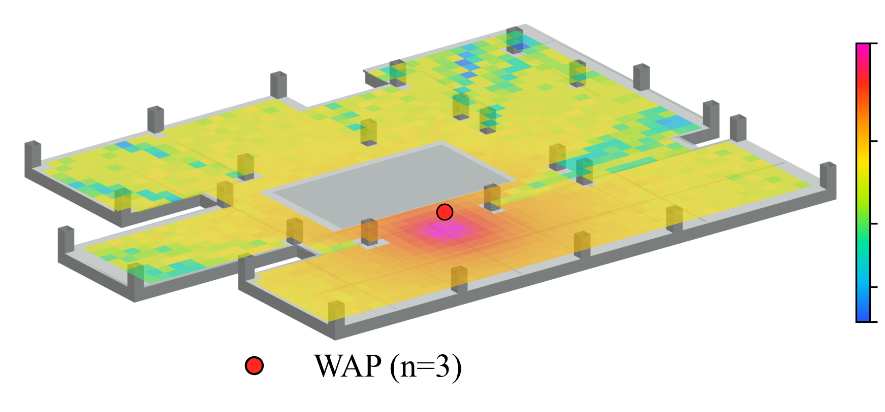 |
|:--:|:--:|:--:|
| Frame PM — RSRP 1F | Frame PM — RSRP 2F | Frame PM — RSRP 3F |

### PM heatmaps — Enclosure stage (RSRP per floor)

| 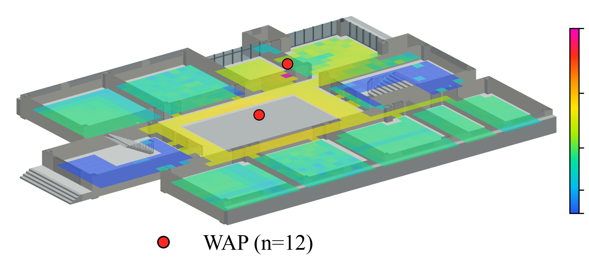 | 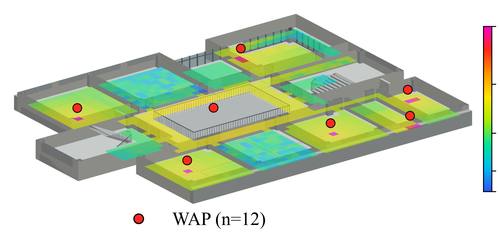 | 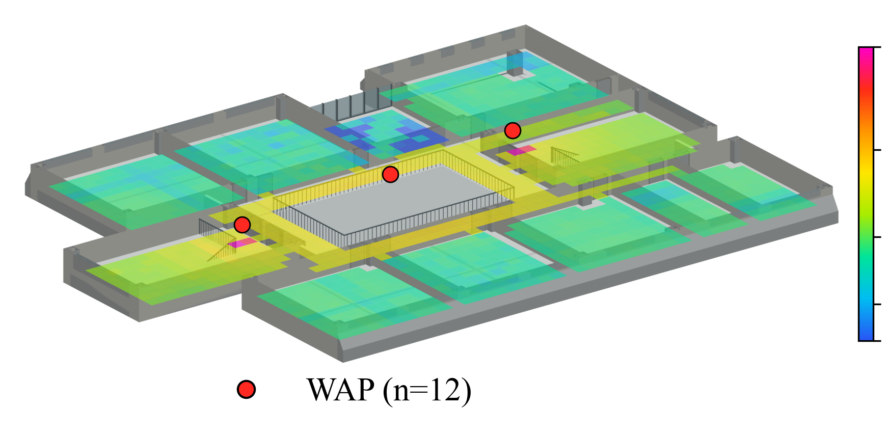 |
|:--:|:--:|:--:|
| Enclosure PM — RSRP 1F | Enclosure PM — RSRP 2F | Enclosure PM — RSRP 3F |

### PM 3D stacked overview — Frame stage

| 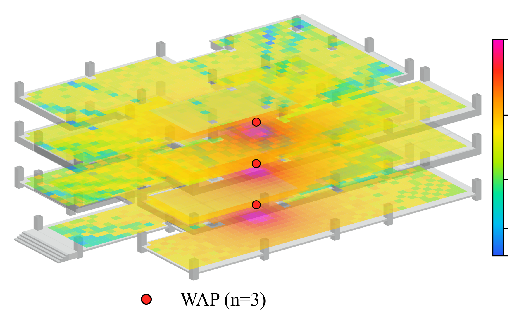 | 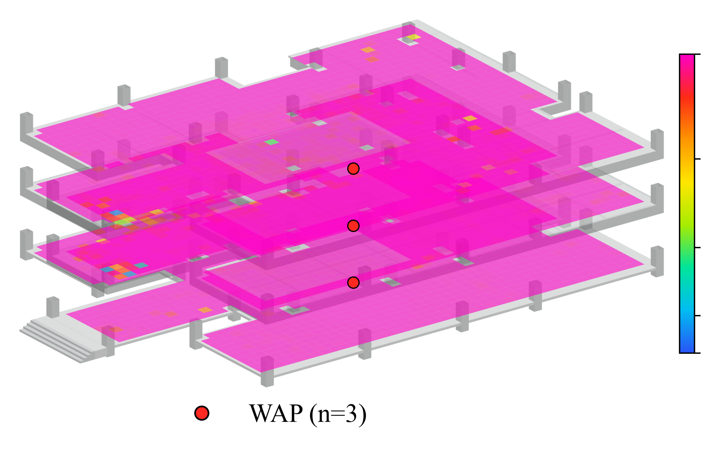 | 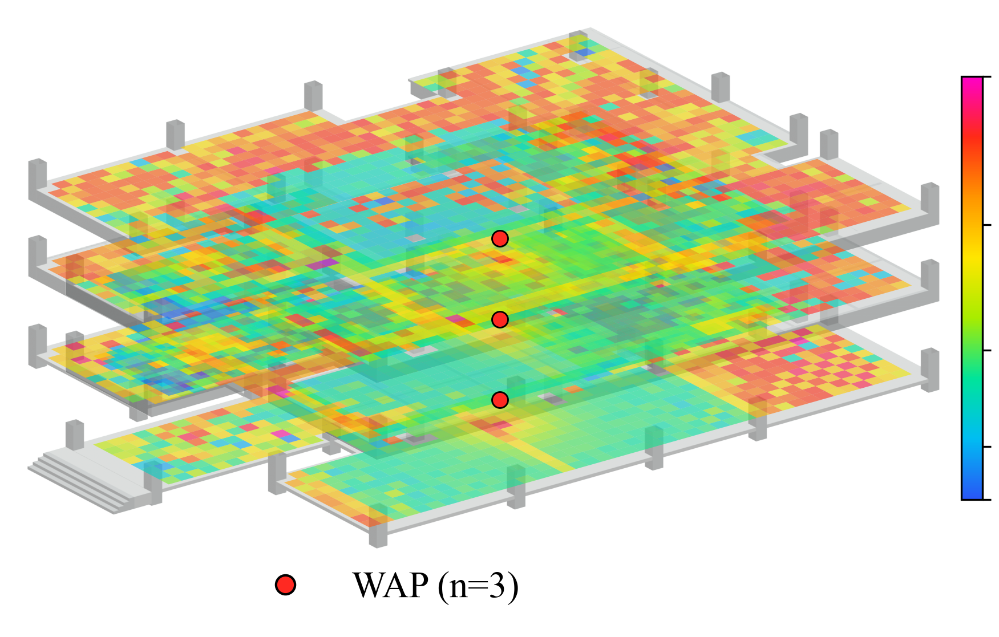 |
|:--:|:--:|:--:|
| Frame PM — RSRP | Frame PM — RSRQ | Frame PM — SINR |

### PM 3D stacked overview — Enclosure stage

| 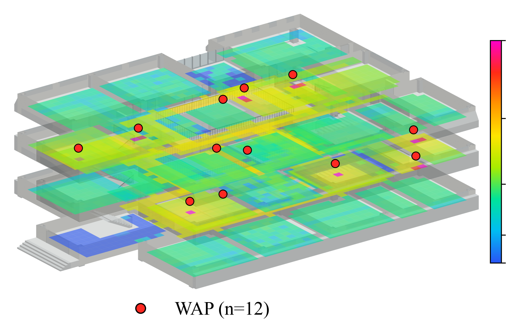 | 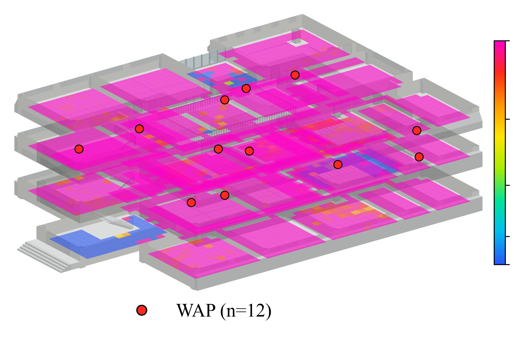 | 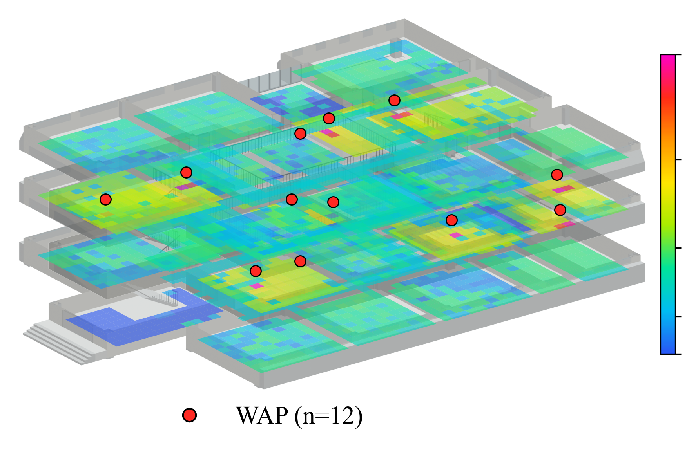 |
|:--:|:--:|:--:|
| Enclosure PM — RSRP | Enclosure PM — RSRQ | Enclosure PM — SINR |

Below are the WAP placement optimization codes and baseline comparison codes:

```
MOO_Framework/tools/wap_layout_optimization/
├── define_problem.py        ← Optimization problem formulation
├── build_surrogate.py        ← Sionna RT surrogate model construction
├── generate_candidates.py    ← 150-site candidate dictionary generation
└── optimize.py              ← GA-based layout optimization + 600-point evaluation

MOO_Framework/baselines/
├── expert_layouts.py        ← EbM1 (Huawei), EbM2 (Akuvox), EbM3 (Siemens)
├── geometric_layouts.py     ← GcM1 (hexagonal), GcM2 (circular) coverage
├── geometry.py              ← Geometric coverage primitives
└── score.py                 ← Unified scoring on common Sionna comparison map
```

↑↑↑ Codes for simulation-based WAP placement optimization and baseline comparisons


## 3.3 Agent-driven WAP placement workflow operation

The agent system automates the complete WAP placement workflow through a **dual-agent plan-and-execute architecture** orchestrating **8 MCP-based agent-usable tools** across **2 MCP servers**.

### MCP Server and Tool Architecture

```
Human Request
     │
     ▼
┌─────────────────┐
│  Planning Agent  │  ← LLM reasoning core
│  (Preliminary    │
│   12-step plan)  │
└────────┬────────┘
         │
         ▼
┌─────────────────┐
│ Execution Agent  │  ← LLM reasoning core (Thought → Action → Observation)
│  (Refine plan &  │
│   invoke tools)  │
└────────┬────────┘
         │
    ┌────┴──────────┐
    ▼               ▼
┌────────────┐ ┌────────────┐
│ BIM MCP    │ │ WAP MCP    │
│ Server     │ │ Server     │
│ (Port 8101)│ │ (Port 8102)│
│            │ │            │
│ 4 tools:   │ │ 4 tools:   │
│ 1.Parse    │ │ 5.Define   │
│ 2.Tessell. │ │ 6.Surrogate│
│ 3.Export   │ │ 7.Candidate│
│ 4.Mitsuba  │ │ 8.Optimize │
└────────────┘ └────────────┘
```

**BIM-based Scene Modelling MCP Server** (`MOO_Framework/mcp_servers/bim_server.py`):
| Tool | Function | Code |
|------|----------|------|
| 1. Parse IFC Building | Parse IFC file, extract building elements and material associations | `MOO_Framework/tools/bim_data_processing/parse_ifc_building.py` |
| 2. Tessellate IFC Objects | Triangulate IFC elements into mesh geometry | `MOO_Framework/tools/bim_data_processing/tessellate_ifc_objects.py` |
| 3. Export Object Meshes | Export PLY meshes + XML scene file with radio materials | `MOO_Framework/tools/bim_data_processing/export_object_meshes.py` |
| 4. Generate Mitsuba Scene | Produce Sionna-compatible Mitsuba XML scene | `MOO_Framework/tools/bim_data_processing/generate_mitsuba_scene.py` |

**WAP Placement Optimization MCP Server** (`MOO_Framework/mcp_servers/wap_server.py`):
| Tool | Function | Code |
|------|----------|------|
| 5. Define Problem | Set up optimization objectives, constraints, and sensor profile | `MOO_Framework/tools/wap_layout_optimization/define_problem.py` |
| 6. Build Surrogate | Build Sionna RT radio map surrogate model | `MOO_Framework/tools/wap_layout_optimization/build_surrogate.py` |
| 7. Generate Candidates | Generate and validate 150-site candidate dictionary | `MOO_Framework/tools/wap_layout_optimization/generate_candidates.py` |
| 8. Optimize | Run GA optimization + evaluate 600-receiver results | `MOO_Framework/tools/wap_layout_optimization/optimize.py` |

A **shared structured data record** maintains data continuity across the tool chain.

### Dual-Agent System

The planning agent (`MOO_Framework/agents/planning_agent.py`) and execution agent (`MOO_Framework/agents/execution_agent.py`) follow a **plan-and-execute** pattern:

1. **Planning Agent** — Receives the human task request, decomposes into an ordered preliminary plan
2. **Execution Agent** — Validates the plan against available MCP tools, produces the final execution sequence, invokes all 8 tools with **Thought–Action–Observation** logging

Each of the **six candidate LLMs** (Claude Opus 5, DeepSeek, Qwen, GPT-6, GPT-5.6 Sol, Grok 4.3) can drive both agents.

```
MOO_Framework/agents/
├── planning_agent.py        ← Receives task, generates 12-step preliminary plan
└── execution_agent.py       ← Validates plan, invokes 8 MCP tools, logs Thought-Action-Observation

MOO_Framework/mcp_servers/
├── bim_server.py            ← Exposes 4 BIM scene modelling tools via MCP
└── wap_server.py            ← Exposes 4 WAP optimization tools via MCP
```

↑↑↑ Codes for the dual-agent system and MCP servers


## 3.4 Optimization results and performance comparison

5 baseline schemes are developed for comparison with the **Proposed Method (PM)**:

**Expert-based Approaches**: Huawei-inspired (EbM1), Akuvox-inspired (EbM2), Siemens-inspired (EbM3)

**Geometric Coverage Methods**: Hexagonal deployment (GcM1), Circular deployment (GcM2)

### 3.4.1 SP3 / SC1 core experimental results

The MOO framework uses DeepSeek, SP3 at 23 dBm, SC1 priority weight 2.

| Stage | PM WAPs | PM F (optimization map) | PM F (common comparison map) | Best baseline F | PM failures / 600 | Min. count proven |
|-------|---------|------------------------|------------------------------|-----------------|-------------------|-------------------|
| Frame | 3 | 0.997597 | 0.997597 | 0.995065 (EbM1/EbM2) | 0 | Yes |
| Enclosure | 12 | 0.987974 | 0.986763 | 0.784174 (EbM3) | 0 | Yes |

### 3.4.2 Comparison with expert-based deployment methods

| Method | Description | Frame F | Enclosure F | PM uplift (Frame) | PM uplift (Enclosure) |
|--------|-------------|---------|-------------|-------------------|----------------------|
| **PM** | Proposed Method (MOO) | **0.998** | **0.987** | — | — |
| EbM1 | Huawei-inspired | 0.995 | 0.673 | +0.3% | +46.6% |
| EbM2 | Akuvox-inspired | 0.995 | 0.679 | +0.3% | +45.4% |
| EbM3 | Siemens-inspired | 0.983 | 0.784 | +1.5% | +25.8% |

### Violin plots — Expert comparison

| 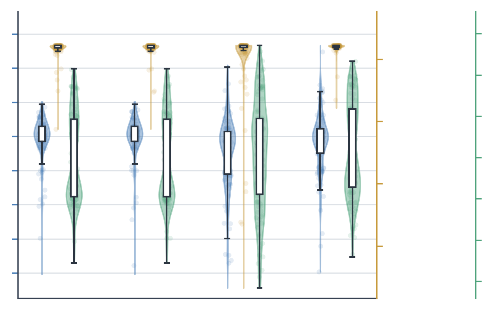 | 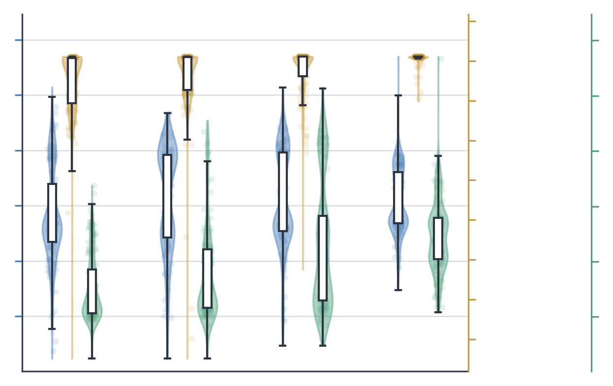 |
|:--:|:--:|
| PM vs EbM1/EbM2/EbM3 — Frame stage | PM vs EbM1/EbM2/EbM3 — Enclosure stage |

### 3.4.3 Comparison with geometric coverage methods

| Method | Description | Frame F | Enclosure F | PM uplift (Frame) | PM uplift (Enclosure) |
|--------|-------------|---------|-------------|-------------------|----------------------|
| **PM** | Proposed Method (MOO) | **0.998** | **0.987** | — | — |
| GcM1 | Hexagonal coverage + GA | 0.860 | 0.674 | +16.0% | +46.3% |
| GcM2 | Circular coverage + GA | 0.792 | 0.682 | +25.9% | +44.7% |

### Violin plots — Geometric comparison

| 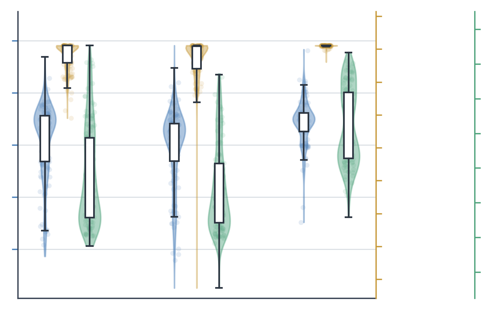 | 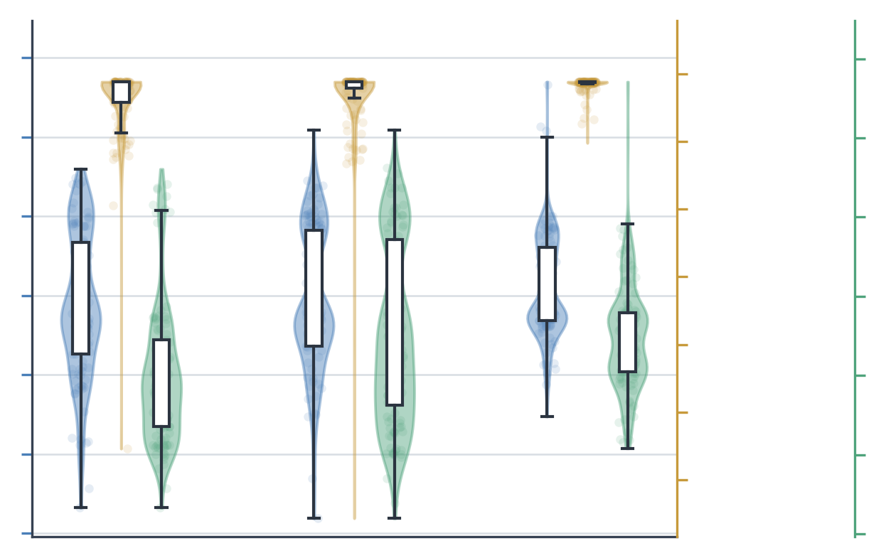 |
|:--:|:--:|
| PM vs GcM1/GcM2 — Frame stage | PM vs GcM1/GcM2 — Enclosure stage |

### 3.4.4 Six-LLM agent task completion rates

The six-LLM benchmark covers **480 formal tasks** (6 models × 2 stages × 5 sensor profiles × 8 scenarios). SP1–SP5 = 13, 18, 23, 28, 33 dBm at 3.5 GHz.

| Model | Family | Tasks completed | Tasks assigned | Completion rate |
|-------|--------|----------------|----------------|-----------------|
| Claude Opus 5 | Anthropic | 80 | 80 | 100% |
| DeepSeek | DeepSeek | 80 | 80 | 100% |
| Qwen (Qianwen) | Alibaba | 80 | 80 | 100% |
| GPT-6 | OpenAI | 80 | 80 | 100% |
| GPT-5.6 Sol | OpenAI | 80 | 80 | 100% |
| Grok 4.3 | xAI | 74 | 80 | 92.5% |
| **Total** | | **474** | **480** | **98.75%** |

Audit records: `MOO_Framework/result/six_llm/completion_rate.json`, `MOO_Framework/result/six_llm/tasks/`, `Supplementary_Tables/Table_S5_Six_LLM_Run_Records.xlsx`.


# 4 Discussion

## 4.1 Case of educational facility

A primary school teaching building (37.45 m × 27.00 m × 13.50 m, three floors, plan area 1,011.15 m²).

**3 experimental dimensions:** 2 construction stages (frame, enclosure) × 5 sensor profiles (SP1–SP5, 13–33 dBm) × 8 smart construction scenes per stage (SC1–SC8, e.g., column inspection, wall plastering, safety monitoring). Each scene has a 3D priority volume (weight 2×); remaining areas weight 1×.

Generate figures:
```
cd MOO_Framework
python plot_registered_floor_heatmaps.py   ← Per-floor RSRP/RSRQ/SINR heatmaps
python plot_stacked_registered_heatmaps.py ← 3D stacked floor overviews
python plot_group_violin.py               ← Per-receiver violin plots
python plot_uplift.py                     ← Uplift bar charts
```

## 4.2 Transferability of the MOO framework

- **Modelling**: IFC2PLY&XML library processes BIM elements; building geometry, materials, and radio parameters are configurable per project.
- **Optimization**: WAP parameters, receiver locations/weights, and coverage requirements are reconfigurable.
- **Operation**: Agent pattern and tool-calling workflow remain unchanged; tool inputs adapt to new buildings.

## 4.3 Method and result boundaries

- The minimum-count proof applies to **600 selected receivers** and **150 candidate WAP sites**, not the continuous work domain.
- Independent dense probes can fail (PM: 6/13,818 frame; 185/12,071 enclosure positions).
- The **global optimum** over all physical sites has not been proven.
- Six-LLM completion rate is based on successful 8-tool execution, not dense-domain validation.


# 5 Quick start

## 5.1 Environment setup

```powershell
git clone https://github.com/yuzhongdexishu/wap-placement-moo.git
cd wap-placement-moo
python -m pip install -r MOO_Framework/requirements.txt

Copy-Item MOO_Framework/config/llm_config.example.json MOO_Framework/config/llm_config.json
Copy-Item MOO_Framework/config/models.example.json MOO_Framework/config/models.json
```
Edit config JSONs with your API keys (gitignored).

## 5.2 Run the MOO framework

```powershell
cd MOO_Framework
python run_all.py        # Terminal 1: BIM (:8101), WAP (:8102), Planning (:7001), Execution (:7002)
python send_task_moo.py  # Terminal 2: frame + enclosure, SP3 (23 dBm), SC1
```
Background launch: `.\_launch_services2.ps1`

## 5.3 Run baseline comparisons

```powershell
cd MOO_Framework
python run_experiment_expert.py    # EbM1/EbM2/EbM3
python run_experiment_geometric.py  # GcM1/GcM2
python run_baseline_comparison.py   # Unified comparison on common Sionna map
```

## 5.4 Generate figures

```powershell
cd MOO_Framework
python plot_registered_floor_heatmaps.py     # Per-floor heatmaps
python plot_stacked_registered_heatmaps.py   # 3D stacked overviews
python plot_group_violin.py                 # Violin plots
python plot_uplift.py                       # Uplift bars
```

## 5.5 Run the six-LLM benchmark

```powershell
cd MOO_Framework
python send_task2.py --dry-run   # Preview
python send_task2.py             # Full 480 tasks
python export_task_table.py      # Export task matrix
```

## 5.6 IFC2PLY&XML standalone library

```bash
pip install ifc2ply_xml
python -m ifc2xml_ply --inputs frame.ifc enclosure.ifc --frequency-ghz 3.5 --output ./output
```

```
ifc2xml_ply/
├── main.py             ← CLI entry point
├── functions/
│   ├── G1–G7           ← Geometry conversion (7 functions)
│   ├── P1–P3           ← Material property conversion (3 functions)
│   └── W1–W7           ← Wireless propagation conversion (7 functions)
└── data/               ← Material library & IFC samples
```

↑↑↑ Open-source IFC2PLY&XML function library (also available on PyPI)